# 🛠️ DiskRescue

[](https://github.com/Kaio-Comk/Disk-Rescue/releases/latest)
[](https://github.com/Kaio-Comk/Disk-Rescue)
[](https://www.python.org/)
[](https://github.com/Kaio-Comk/Disk-Rescue)
[](LICENSE)

**Sistema Unificado e Autônomo para Diagnóstico Profundo, Clonagem Resiliente e Recuperação Forense de Discos.**

O **DiskRescue** é uma suíte de engenharia reversa e recuperação de dados projetada para HDDs, SSDs, pendrives e mídias removíveis. Ele combina análise estrutural de baixo nível (parsers nativos de MBR, GPT, NTFS, FAT32 e exFAT), telemetria S.M.A.R.T. preditiva com isolamento de falhas de cabo SATA, motor de clonagem em duas fases (estilo GNU `ddrescue`) com contabilização integral de LBAs e mapa atômico de retomada, extração direta contínua de arquivos (*File Carving*) com validação estrutural pós-extração e suporte multi-bloco, além de visualização gráfica de latência de superfície (*Heatmap*).

A aplicação conta com uma interface desktop moderna no padrão **Windows 11 Fluent Design** e é distribuída como binário portátil autônomo (`DiskRescue.exe`) com solicitação nativa de privilégios de administrador (UAC).

---

## ⚡ Download Imediato do Executável

Baixe a versão mais recente pronta para uso:
👉 **[Baixar DiskRescue v0.2.3 (Executável Portátil)](https://github.com/Kaio-Comk/Disk-Rescue/releases/latest)**

* **Portátil e Autônomo:** Não requer instalação de Python nem dependências externas (~11.6 MB).
* **Integridade Criptográfica (SHA-256):**
  ```text
  2863FCBF13410F82BA8D7682D03B518AD455425E19E74598CF987A6B8F02E4E3
  ```
* **Elevação UAC Automática:** Manifest embutido solicita privilégios de Administrador ao iniciar, garantindo acesso direto de baixo nível (`\\.\PhysicalDriveX`).

---

## 🧭 O Problema: Por que Ferramentas Tradicionais Falham?

1. **`chkdsk` é Destrutivo:** Ao encontrar corrupção de metadados em discos com setores defeituosos, o `chkdsk` do Windows trunca arquivos, descarta registros da MFT e sobrescreve setores, inviabilizando a recuperação forense.
2. **Cópia Convencional Congela o Disco:** Ferramentas como o Windows Explorer ou `xcopy` insistem repetidamente em setores com erro de I/O, provocando atrito, aquecimento e falha mecânica definitiva (*head crash*).
3. **Diagnósticos Imprecisos Condenam Discos Bons:** Muitas ferramentas rotulam um disco como "defeituoso" simplesmente por erros de comunicação no cabo SATA frouxo ou oxidado (`ID C7 UltraDMA CRC`), sem inspecionar a integridade real dos pratos magnéticos.

---

## 🏗️ Arquitetura do Sistema

```mermaid
flowchart TD
    subgraph UI ["Camada de Apresentação (GUI & CLI)"]
        GUI["Painel Desktop Fluent Design (Tkinter + sv_ttk)"]
        CLI["CLI Forense (Rich Terminal)"]
    end

    subgraph Core ["Motor Central do DiskRescue (core/)"]
        Orquestrador["Orquestrador de Diagnóstico"]
        
        subgraph Hardware ["Hardware & Telemetria (core.hardware)"]
            DevScanner["Device Scanner (PhysicalDrive / WMI)"]
            DevResolver["Device Resolver (IOCTL_STORAGE_GET_DEVICE_NUMBER)"]
            WriteBlocker["Write-Blocker I/O Layer (StrictReadOnlyDeviceStream)"]
            SmartEngine["SMART Probabilistic Engine & Report"]
            SurfaceScanner["Surface Latency Scanner & Heatmap"]
        end
        
        subgraph Partition ["Particionamento (core.partition)"]
            GptParser["GPT Parser & Recalculador CRC32"]
            MbrParser["MBR Parser & Reparador 0x55AA"]
        end
        
        subgraph Filesystem ["Sistemas de Arquivos (core.filesystem)"]
            NtfsEngine["NTFS Engine (BPB, VBR Swap & MFT Check)"]
            FatExfatEngine["FAT32 & exFAT Forensic Scanners"]
        end
        
        subgraph Recovery ["Motores de Resgate (core.recovery)"]
            BackupManager["LBA Snapshot & Rollback Engine"]
            ResilientCloner["Clonagem Resiliente 2-Fases (Modo ddrescue com .map atômico)"]
            FileCarver["File Carver Forense Multi-bloco (JPG, PNG, PDF, ZIP)"]
        end
    end

    subgraph HardwareLayer ["Dispositivos Físicos"]
        RawDisk["Disco com Defeito - PhysicalDriveX"]
        SafeTarget["Disco de Destino Independente - Imagem .img"]
    end

    GUI --> Orquestrador
    CLI --> Orquestrador
    
    Orquestrador --> DevScanner
    Orquestrador --> DevResolver
    Orquestrador --> WriteBlocker
    Orquestrador --> SmartEngine
    Orquestrador --> SurfaceScanner
    Orquestrador --> GptParser
    Orquestrador --> MbrParser
    Orquestrador --> NtfsEngine
    Orquestrador --> FatExfatEngine
    Orquestrador --> BackupManager
    Orquestrador --> ResilientCloner
    Orquestrador --> FileCarver

    DevScanner -.-> RawDisk
    SurfaceScanner -.-> RawDisk
    GptParser -.-> RawDisk
    MbrParser -.-> RawDisk
    NtfsEngine -.-> RawDisk
    BackupManager -.-> SafeTarget
    ResilientCloner -.-> SafeTarget
    FileCarver -.-> SafeTarget
```



---

## 🚀 Capacidades & Módulos Técnicos

### 1. 🔍 Recuperador de Boot Sector NTFS (Swap com Backup de Volume)
* Volumes NTFS armazenam uma cópia espelho exata do setor de inicialização no último setor do volume (`total_sectors - 1`).
* O DiskRescue detecta quando o *Primary Boot Sector* foi danificado (deixando o disco no estado **RAW**), valida o setor de backup e restaura a inicialização com **snapshot binário preventivo**.

### 2. 📊 Telemetria S.M.A.R.T. Preditiva com Rigor Forense
* **Separação Estruturada:** Cada relatório separa categoricamente **Evidências Observadas**, **Hipóteses Prováveis**, **Limitações da Telemetria** e **Ações Sugeridas**.
* **Sem Falsos Normalizados:** O sistema não injeta valores normalizados fictícios (`current=100`, `worst=100`, etc.) quando apenas contadores brutos são fornecidos pelo sistema operacional.
* **Diagnóstico Probabilístico de Cabo SATA (ID C7):** Quando ocorrem erros de CRC UltraDMA sem setores pendentes ou realocados, o relatório apresenta a hipótese de falha elétrica no cabo/conector SATA e recomenda a criação de imagem antes de qualquer ação, sem garantir saúde total prematura da mídia.
* **Cuidado na Recomendação:** Nenhum disco é rotulado como "100% seguro para reparo", preservando a regra de sempre gerar snapshot ou imagem antes de qualquer intervenção.

### 3. 💾 Motor de Clonagem Resiliente em Duas Fases (Estilo `ddrescue`)
* **Contabilização Integral de LBAs:** Todos os setores no intervalo `[0, total_sectors)` são rigorosamente mapeados como `+` (resgatado), `*` (pulado na Fase 1 para evitar atrito mecânico) ou `-` (bad sector irrecuperável confirmado na Fase 2). Zero lacunas silenciosas preenchidas com zeros sem registro.
* **Fase 1 (Fast Pass):** Varre blocos grandes copiando rapidamente as áreas íntegras. Ao encontrar um bad sector, salta à frente para afastar as cabeças magnéticas da região degradada e registra toda a faixa saltada para raspagem posterior.
* **Fase 2 (Surgical Scraping):** Raspa setor por setor (512 bytes) em todas as regiões puladas. Setores ilegíveis recebem zeros para preservar o offset exato da imagem.
* **Arquivo de Mapa Atômico e Durável (`.map`):** Validação estrita de intervalos contíguos sem sobreposições e coerência física com a imagem em disco. Persistência atômica via arquivo temporário, `fsync` de durabilidade e `os.replace`. Retomada verídica que pula blocos já resgatados e continua exatamente dos setores pendentes.
* **Diferenciação de Resultado:** Distinção explícita entre clonagem 100% íntegra (`fully_recovered=True`) e clonagem com resgate parcial preenchida com zeros em bad sectors.

### 4. 🧩 Suporte a Partições MBR Legadas
* Parser completo de entradas MBR clássicas (LBA 0), validação de assinatura `0x55AA` e injeção/reconstrução cirúrgica de partições órfãs identificadas por varredura forense.

### 5. 🔬 Scanners Forenses para FAT32 e exFAT
* Suporte nativo a pendrives e cartões de memória (SD/microSD).
* Decodifica o BIOS Parameter Block (BPB), extrai tabelas FAT, calcula o cluster raiz e identifica volumes órfãos mesmo sem tabela de partição registrada.

### 6. 📁 File Carving Forense Contínuo (Multi-bloco e Streaming em Disco)
* Extração direta a partir de fluxos de setores brutos com **streaming direto em disco (spooling)** e consumo de memória $O(1)$ (buffer deslizante de até 128 KB), suportando arquivos de dezenas e centenas de megabytes através de fronteiras de blocos.
* Delimitadores suportados:
  * **JPG / JPEG:** Cabeçalho `FF D8 FF`, marcador de quadro válido e trailer `FF D9`.
  * **PNG:** Assinatura `89 50 4E 47 0D 0A 1A 0A`, validação do primeiro chunk `IHDR` e trailer `IEND`.
  * **PDF:** Cabeçalho `%PDF-`, marcadores estruturais (`xref`, `trailer`, `startxref`) e delimitador `%%EOF`.
  * **ZIP / DOCX / XLSX:** Cabeçalho `PK\x03\x04` e End of Central Directory (`PK\x05\x06`).
* **Validação Estrutural e Isolamento:** Verificação pós-extração (`zipfile.testzip()`, integridade de marcadores PDF/PNG/JPEG). Falsos positivos e arquivos corrompidos são isolados com sufixo `_corrupted` ou descartados (`discard_invalid=True`), nunca contabilizados como resgates íntegros.

### 7. 📈 Varredura de Superfície com Mapa de Calor (Heatmap)
* Medição de latência precisa por bloco com classificação visual em tempo real:
  * 🟢 **< 20 ms (Verde):** Excelente estado magnético.
  * 🔵 **< 100 ms (Azul):** Latência normal de rotação mecânica.
  * 🟡 **< 250 ms (Amarelo):** Início de fadiga de superfície.
  * 🟠 **< 1000 ms (Laranja):** Retentativas críticas de ECC de hardware.
  * 🔴 **Bad Sector (Vermelho):** Erro irrecuperável de I/O.
* Cancelamento gracioso a qualquer instante.

---

## 🗂️ As 6 Abas da Interface Gráfica

| Aba | Função Principal |
|---|---|
| **🔍 Diagnóstico & Reparo** | Validação de tabelas GPT/MBR, detecção de volumes RAW e Swap de Boot Sector NTFS com 1 clique. |
| **📊 Telemetria SMART** | Cards visuais de Saúde, Temperatura, Horas e Alerta Contextual de Cabo SATA. Distinção rigorosa entre erros de leitura do SO e bad sectors reais (ID 197), com estado Cinza (Indisponível) para dispositivos sem telemetria. |
| **💾 Clonagem Resiliente** | Espelhamento forense com pulo inteligente de bad sectors e arquivo `.map` para retomar. |
| **🔬 File Carving** | Varredura profunda de fotos, documentos e arquivos ZIP deletados diretamente da mídia bruta com spooling streaming. |
| **📈 Varredura de Superfície** | Grid visual interativo com mapa de calor de latência de leitura setor por setor. |
| **📝 Log Forense** | Terminal ao vivo com histórico de operações, LBAs inspecionados e exportação de relatório. |

---

## 🛡️ Política de Segurança Inviolável (*Do No Harm*)

O DiskRescue foi concebido com foco absoluto na integridade física e preservação dos dados:
1. **Software Write-Guard por Padrão ("Do No Harm"):** Suíte auditada com `StrictReadOnlyDeviceStream`. Intercepta no nível de processo qualquer tentativa indevida de escrita (`write`, `writelines`, `truncate`), levantando `WriteBlockViolationError`. *(Nota forense: atua como barreira de proteção de software de alto nível; para custódia pericial de bancada física, recomenda-se complementar com hardware write-blocker dedicado).*
2. **Bloqueio P0 Fail-Closed Universal de Disco Físico (Device Resolver):** Resolução profunda de hardware via `IOCTL_STORAGE_GET_DEVICE_NUMBER` com protótipos Win32 64-bit explícitos (`ctypes.wintypes.HANDLE`), suportando letras de unidade, dispositivos `PhysicalDriveN` e caminhos de Volume GUID (`\\?\Volume{...}`). Adota política Fail-Closed universal: se a identidade física de origem ou destino não puder ser categoricamente comprovada como independente, a operação é bloqueada preventivamente.
3. **Proteção de Integridade do Mapa (`map_path`):** O arquivo de mapa é protegido contra colisão com a própria imagem de saída (evitando sobrescrita acidental) e impedido de ser gravado no disco físico de origem.
4. **Validação de Imagem na Retomada (Resume):** Rejeita retomar clonagens quando o arquivo físico de imagem em disco estiver ausente ou truncado em relação ao tamanho total esperado dos setores.
5. **Snapshots Preventivos Obrigatórios:** Nenhuma gravação de setor físico é executada sem que uma cópia binária exata do setor original seja gravada no disco local (`mbr_backup_*.bin`, `ntfs_vbr_backup_*.bin`).
6. **Validação Estrutural Profunda Pós-Carving:** Verificação pós-extração com cálculo real de CRC32 em chunks PNG, validação de marcadores e dimensões SOF em JPEG, verificação de offset `startxref` em PDF e `zipfile.testzip()` em arquivos compactados. Falsos positivos são descartados ou isolados.
7. **Cancelamento Gracioso:** Todas as threads de clonagem, varredura de superfície e carving respondem a sinais de interrupção imediata preservando o progresso salvo.

---

## 🧪 Cobertura de Testes Automatizados

O sistema conta com suíte completa de 40 testes unitários automatizados com discos sintéticos em memória, streams bloqueadores e arquivos temporários:

```bash
$ pytest tests/ -v
============================= test session starts =============================
tests/test_carver.py::test_carver_detects_and_extracts_files PASSED      [  2%]
tests/test_carver.py::test_carver_cross_block_large_file_over_1mb PASSED [  5%]
tests/test_carver.py::test_carver_file_crossing_boundary_over_4kb PASSED [  7%]
tests/test_carver.py::test_carver_handles_false_signatures_and_truncated_files PASSED [ 10%]
tests/test_carver.py::test_carver_extracts_png_with_ihdr_and_iend PASSED [ 12%]
tests/test_carver.py::test_carver_rejects_negative_or_zero_chunk_sectors PASSED [ 15%]
tests/test_carver.py::test_carver_does_not_overwrite_existing_recovered_files PASSED [ 17%]
tests/test_carver.py::test_carver_rejects_anonymous_unidentified_stream PASSED [ 20%]
tests/test_fat_exfat.py::test_parse_fat32_and_exfat PASSED               [ 22%]
tests/test_fat_exfat.py::test_scan_boot_sectors_discovers_fat32_and_exfat PASSED [ 25%]
tests/test_gpt_repair.py::test_parse_gpt_valida_crc PASSED               [ 27%]
tests/test_gpt_repair.py::test_rebuild_gpt_corrige_offset_e_recalcula_crc PASSED [ 30%]
tests/test_mbr.py::test_parse_and_rebuild_mbr PASSED                     [ 32%]
tests/test_mbr.py::test_repair_mbr_partition_in_file PASSED              [ 35%]
tests/test_ntfs_boot_repair.py::test_diagnose_and_restore_ntfs_boot_sector PASSED [ 37%]
tests/test_resilient_clone.py::test_resilient_clone_clean_disk PASSED    [ 40%]
tests/test_resilient_clone.py::test_resilient_clone_synthetic_lba_exact_verification PASSED [ 42%]
tests/test_resilient_clone.py::test_resilient_clone_resume_from_interrupted_map PASSED [ 45%]
tests/test_resilient_clone.py::test_clone_map_rejects_mismatched_device PASSED [ 47%]
tests/test_resilient_clone.py::test_clone_parameters_strictly_positive PASSED [ 50%]
tests/test_resilient_clone.py::test_clone_map_rejects_corrupted_or_gapped_intervals PASSED [ 52%]
tests/test_resilient_clone.py::test_cloner_rejects_map_path_identical_to_output_image PASSED [ 55%]
tests/test_resilient_clone.py::test_cloner_rejects_map_path_on_same_physical_disk_as_source PASSED [ 57%]
tests/test_safety_write_blocker.py::test_strict_read_only_stream_throws_on_any_write PASSED [ 60%]
tests/test_safety_write_blocker.py::test_instrumented_stream_with_carver_and_parsers PASSED [ 62%]
tests/test_safety_write_blocker.py::test_cloner_source_never_receives_writes PASSED [ 65%]
tests/test_safety_write_blocker.py::test_physical_drive_conflict_detection_blocks_same_disk PASSED [ 67%]
tests/test_safety_write_blocker.py::test_cloner_blocks_exact_same_file PASSED [ 70%]
tests/test_safety_write_blocker.py::test_carver_structural_integrity_verification PASSED [ 72%]
tests/test_safety_write_blocker.py::test_physical_drive_conflict_fail_closed_when_unresolved PASSED [ 75%]
tests/test_safety_write_blocker.py::test_physical_drive_conflict_fail_closed_when_destination_physical_and_source_unresolved PASSED [ 77%]
tests/test_safety_write_blocker.py::test_volume_guid_conflict_detection PASSED [ 80%]
tests/test_smart_diagnostics.py::test_smart_healthy PASSED               [ 82%]
tests/test_smart_diagnostics.py::test_smart_sata_cable_fault_detected PASSED [ 85%]
tests/test_smart_diagnostics.py::test_smart_surface_critical_degradation PASSED [ 87%]
tests/test_smart_diagnostics.py::test_smart_mechanical_spin_retry PASSED [ 90%]
tests/test_smart_diagnostics.py::test_smart_no_telemetry_returns_unknown PASSED [ 92%]
tests/test_smart_diagnostics.py::test_smart_read_errors_not_confused_with_pending_sectors PASSED [ 95%]
tests/test_smart_diagnostics.py::test_smart_windows_reliability_counters_remain_segregated_and_unknown PASSED [ 97%]
tests/test_surface_scan.py::test_surface_scan_measures_blocks PASSED     [100%]

============================= 40 passed in 3.37s ==============================
```
```

---

## 💻 Instalação e Execução para Desenvolvedores

### Pré-requisitos
* Python 3.11 ou 3.12 (64-bit) no Windows.

### Configuração do Ambiente
```powershell
# 1. Clonar o repositório
git clone https://github.com/Kaio-Comk/Disk-Rescue.git
cd Disk-Rescue

# 2. Criar e ativar ambiente virtual (PowerShell)
python -m venv .venv
.\.venv\Scripts\Activate.ps1

# 3. Instalar dependências em modo editável
pip install -e ".[gui,dev]"
```

### Executando a Aplicação
```bash
# Interface Gráfica Windows 11 Fluent
python diskrescue_gui.pyw

# Ou Modo Linha de Comando (CLI)
python -m cli.main
```

### Compilando o Executável Portátil (`.exe`)
```bash
pyinstaller --clean DiskRescue.spec
# O binário compilado estará em dist/DiskRescue.exe
```

---

## 📄 Licença

Distribuído sob a licença **MIT**. Consulte `LICENSE` para mais detalhes.
Criado e mantido por **Kaio Lima**.
