# 🛠️ DiskRescue

[](https://github.com/Kaio-Comk/Disk-Rescue/releases/latest)
[](https://github.com/Kaio-Comk/Disk-Rescue)
[](https://www.python.org/)
[](https://github.com/Kaio-Comk/Disk-Rescue)
[](LICENSE)

**Sistema Unificado e Autônomo para Diagnóstico Profundo, Clonagem Resiliente e Recuperação Forense de Discos.**

O **DiskRescue** é uma suíte de engenharia reversa e recuperação de dados projetada para HDDs, SSDs, pendrives e mídias removíveis. Ele combina análise estrutural de baixo nível (parsers nativos de MBR, GPT, NTFS, FAT32 e exFAT), telemetria S.M.A.R.T. preditiva com isolamento de falhas de cabo SATA, motor de clonagem em duas fases (estilo GNU `ddrescue`) com contabilização integral de LBAs e mapa atômico de retomada, extração direta contínua de arquivos (*File Carving*) com validação estrutural pós-extração e suporte multi-bloco, além de visualização gráfica de latência de superfície (*Heatmap*).

A aplicação conta com uma interface desktop moderna no padrão **Windows 11 Fluent Design** com barra lateral de navegação (Sidebar Rail), dashboard executivo de saúde física e é distribuída como binário portátil autônomo (`DiskRescue.exe`) com ícone oficial multi-resolução e solicitação nativa de privilégios de administrador (UAC).

---

## ⚡ Download Imediato do Executável

Baixe a versão mais recente pronta para uso:
👉 **[Baixar DiskRescue v0.3.2 (Executável Portátil)](https://github.com/Kaio-Comk/Disk-Rescue/releases/latest)**

* **Portátil e Autônomo:** Não requer instalação de Python nem dependências externas (~31.2 MB).
* **Integridade Criptográfica (SHA-256):**
  ```text
  32CC51C4437CA781F006A6670C42CE1356C79CF1127BCF39E7FA3B606C4F567C
  ```
* **Elevação UAC Automática:** Manifest embutido solicita privilégios de Administrador ao iniciar, garantindo acesso direto de baixo nível (`\\.\PhysicalDriveX`).
* **Identidade Visual Nativa:** Ícone `.ico` oficial embutido no executável (resoluções de 16x16 a 256x256).

---

## 🧭 O Problema: Por que Ferramentas Tradicionais Falham?

1. **`chkdsk` é Destrutivo:** Ao encontrar corrupção de metadados em discos com setores defeituosos, o `chkdsk` do Windows trunca arquivos, descarta registros da MFT e sobrescreve setores, inviabilizando a recuperação forense.
2. **Cópia Convencional Congela o Disco:** Ferramentas como o Windows Explorer ou `xcopy` insistem repetidamente em setores com erro de I/O, provocando atrito, aquecimento e falha mecânica definitiva (*head crash*).
3. **Diagnósticos Imprecisos Condenam Discos Bons:** Muitas ferramentas rotulam um disco como "defeituoso" simplesmente por erros de comunicação no cabo SATA frouxo ou oxidado (`ID C7 UltraDMA CRC`), sem inspecionar a integridade real dos pratos magnéticos.

---

## 🏗️ Arquitetura do Sistema

```mermaid
flowchart TD
    subgraph UI ["Camada de Apresentação (GUI & CLI)"]
        GUI["Painel Desktop Fluent Design (Sidebar + Dashboard + 7 Módulos)"]
        CLI["CLI Forense (Rich Terminal)"]
    end

    subgraph Core ["Motor Central do DiskRescue (core/)"]
        Orquestrador["Orquestrador de Diagnóstico"]
        
        subgraph Hardware ["Hardware & Telemetria (core.hardware)"]
            DevScanner["Device Scanner (PhysicalDrive / WMI)"]
            DevResolver["Device Resolver (IOCTL_STORAGE_GET_DEVICE_NUMBER)"]
            WriteBlocker["Write-Blocker I/O Layer (StrictReadOnlyDeviceStream)"]
            SmartEngine["SMART Probabilistic Engine & Report"]
            SurfaceScanner["Surface Latency Scanner & Heatmap"]
        end
        
        subgraph Partition ["Particionamento (core.partition)"]
            GptParser["GPT Parser & Recalculador CRC32"]
            MbrParser["MBR Parser & Reparador 0x55AA"]
        end
        
        subgraph Filesystem ["Sistemas de Arquivos (core.filesystem)"]
            NtfsEngine["NTFS Engine (BPB, VBR Swap & MFT Check)"]
            FatExfatEngine["FAT32 & exFAT Forensic Scanners"]
        end
        
        subgraph Recovery ["Motores de Resgate (core.recovery)"]
            BackupManager["LBA Snapshot & Rollback Engine"]
            ResilientCloner["Clonagem Resiliente 2-Fases (Modo ddrescue com .map atômico)"]
            FileCarver["File Carver Forense Multi-bloco (JPG, PNG, PDF, ZIP)"]
        end
    end

    subgraph HardwareLayer ["Dispositivos Físicos"]
        RawDisk["Disco com Defeito - PhysicalDriveX"]
        SafeTarget["Disco de Destino Independente - Imagem .img"]
    end

    GUI --> Orquestrador
    CLI --> Orquestrador
    
    Orquestrador --> DevScanner
    Orquestrador --> DevResolver
    Orquestrador --> WriteBlocker
    Orquestrador --> SmartEngine
    Orquestrador --> SurfaceScanner
    Orquestrador --> GptParser
    Orquestrador --> MbrParser
    Orquestrador --> NtfsEngine
    Orquestrador --> FatExfatEngine
    Orquestrador --> BackupManager
    Orquestrador --> ResilientCloner
    Orquestrador --> FileCarver

    DevScanner -.-> RawDisk
    SurfaceScanner -.-> RawDisk
    GptParser -.-> RawDisk
    MbrParser -.-> RawDisk
    NtfsEngine -.-> RawDisk
    BackupManager -.-> SafeTarget
    ResilientCloner -.-> SafeTarget
    FileCarver -.-> SafeTarget
```



---

## 🗂️ Os 7 Módulos da Interface Gráfica (Windows 11 Fluent)

A versão `v0.3.2` consolida auditoria corretiva com segurança aprofundada de dados, dual snapshot dinâmico e rollback verificado em GPT, restauração cirúrgica de Boot Sector NTFS com verificação preventiva, thread-safety com estados operacionais explícitos (`OperationState`), cancelamento cooperativo de carver e telemetria SMART estendida:

| Módulo | Descrição & Capacidades |
|---|---|
| **📊 Visão Geral (Dashboard)** | Painel executivo consolidado com badge de confiabilidade, diretriz técnica recomendada, atalhos rápidos e inventário de partições detectadas. |
| **🔍 Diagnóstico & Partições** | Inspeção comparativa lado a lado entre a tabela oficial (GPT/MBR) e boot sectors reais na mídia física. Diagnóstico de desalinhamento, realinhamento dinâmico GPT e restauração cirúrgica de VBR com backup preventivo. |
| **📈 Telemetria S.M.A.R.T.** | 6 cards visuais de telemetria ATA, isolamento contextual de cabo SATA com ruído elétrico (ID C7), temperatura, avaliação de atributos estendidos (IDs 184, 187, 188, 196) e honestidade técnica sobre barramento USB. |
| **💾 Clonagem Resiliente** | Motor de resgate em duas fases (Fast Pass + Scraping fino), barra de progresso em tempo real, métricas de velocidade (MB/s), setores resgatados vs bad sectors e persistência atômica em arquivo de mapa `.map`. |
| **🔬 File Carving Forense** | Recuperação por assinaturas mágicas (JPG, PNG, PDF, ZIP, DOCX) diretamente de setores brutos com streaming em disco (spooling), filtros de extensão, botão de cancelamento cooperativo e abertura rápida da pasta. |
| **⚡ Varredura de Superfície** | Grade de blocos interativa com mapa de calor de latência de leitura (estilo MHDD / Victoria), medindo tempos de resposta (< 20ms até Atraso Crítico e Bad Sector). |
| **📝 Console de Logs** | Terminal integrado de auditoria em tempo real, com timestamp detalhado e exportação de relatórios em `.txt`. |

---

## 🛡️ Política de Segurança Inviolável (*Do No Harm*)

O DiskRescue foi concebido com foco absoluto na integridade física e preservação dos dados:
1. **Software Write-Guard por Padrão ("Do No Harm"):** Suíte auditada com `StrictReadOnlyDeviceStream`. Intercepta no nível de processo qualquer tentativa indevida de escrita (`write`, `writelines`, `truncate`), levantando `WriteBlockViolationError`.
2. **Bloqueio P0 Fail-Closed Universal de Disco Físico (Device Resolver):** Resolução profunda de hardware via `IOCTL_STORAGE_GET_DEVICE_NUMBER` com protótipos Win32 64-bit explícitos (`ctypes.wintypes.HANDLE`), suportando letras de unidade, dispositivos `PhysicalDriveN` e caminhos de Volume GUID (`\\?\Volume{...}`). Adota política Fail-Closed universal: se a identidade física de origem ou destino não puder ser comprovada como independente, a operação é bloqueada preventivamente.
3. **Proteção de Integridade do Mapa (`map_path`):** O arquivo de mapa é protegido contra colisão com a própria imagem de saída (evitando sobrescrita acidental) e impedido de ser gravado no disco físico de origem.
4. **Validação de Imagem na Retomada (Resume):** Rejeita retomar clonagens quando o arquivo físico de imagem em disco estiver ausente ou truncado em relação ao tamanho total esperado dos setores.
5. **Snapshots Preventivos Obrigatórios e Rollback Verificado:** Nenhuma gravação de setor físico é executada sem que cópias binárias exatas das regiões originais (tanto primária quanto de backup, calculadas dinamicamente sem limite arbitrário de setores) sejam gravadas e relidas preventivamente do disco local (`backup_gpt_primary_*.bin`, `backup_gpt_secondary_*.bin`, `corrupted_vbr_*.bin`), com rollback atômico e verificação pós-restauração.
6. **Gravação Atômica de Imagens com Staging Exclusivo e Status Detalhado:** `create_raw_disk_image()` rejeita arquivos existentes por padrão (`allow_overwrite=False`), grava via `tempfile.mkstemp` em arquivo temporário isolado (`.tmp`), valida alinhamento estrito de setores, sincroniza via `fsync`, substitui atomicamente via `os.replace` e retorna objeto explícito `RawImageResult`.
7. **Thread Safety Estrita na GUI e Estados Operacionais:** Todas as alterações de componentes visuais, diálogos modais e atualizações de estado ocorrem estritamente na thread principal via fila thread-safe (`msg_queue`) e poller de eventos assíncrono. Estados operacionais explícitos (`OperationState`) e cancelamento cooperativo no File Carver garantem confiabilidade.
8. **Validação Estrutural Profunda Pós-Carving:** Verificação pós-extração com cálculo real de CRC32 em chunks PNG, validação de marcadores e dimensões SOF em JPEG, verificação de offset `startxref` em PDF e `zipfile.testzip()` em arquivos compactados. Falsos positivos são descartados ou isolados.
9. **Cancelamento Gracioso e Interrupção Segura:** Todas as threads de clonagem, varredura de superfície e carving respondem a sinais de interrupção imediata preservando o progresso salvo e confirmando o encerramento no fechamento da aplicação (`WM_DELETE_WINDOW`).

---

## 🧪 Cobertura de Testes Automatizados

O sistema conta com suíte completa de **80 testes unitários e de integração de interface** automatizados:

```bash
$ pytest tests/ -v
============================= test session starts =============================
tests/test_carver.py::test_carver_detects_and_extracts_files PASSED      [  1%]
tests/test_carver.py::test_carver_cross_block_large_file_over_1mb PASSED [  3%]
tests/test_carver.py::test_carver_file_crossing_boundary_over_4kb PASSED [  4%]
tests/test_carver.py::test_carver_handles_false_signatures_and_truncated_files PASSED [  6%]
tests/test_carver.py::test_carver_extracts_png_with_ihdr_and_iend PASSED [  7%]
tests/test_carver.py::test_carver_rejects_negative_or_zero_chunk_sectors PASSED [  9%]
tests/test_carver.py::test_carver_does_not_overwrite_existing_recovered_files PASSED [ 10%]
tests/test_carver.py::test_carver_rejects_anonymous_unidentified_stream PASSED [ 12%]
tests/test_carver.py::test_carver_detects_header_split_across_block_boundary PASSED [ 13%]
tests/test_fat_exfat.py::test_parse_fat32_and_exfat PASSED               [ 15%]
tests/test_fat_exfat.py::test_scan_boot_sectors_discovers_fat32_and_exfat PASSED [ 16%]
tests/test_gpt_repair.py::test_parse_gpt_valida_crc PASSED               [ 18%]
tests/test_gpt_repair.py::test_rebuild_gpt_corrige_offset_e_recalcula_crc PASSED [ 20%]
tests/test_gpt_repair.py::test_gpt_parser_rejects_malformed_structures PASSED [ 21%]
tests/test_gpt_repair.py::test_repair_gpt_partition_offset_syncs_backup_and_rejects_overlaps PASSED [ 23%]
tests/test_gpt_repair.py::test_repair_gpt_validates_backup_dir_before_mkdir PASSED [ 24%]
tests/test_gui_lifecycle.py::test_gui_instantiation_and_views_presence PASSED [ 26%]
tests/test_gui_lifecycle.py::test_gui_render_disks_list PASSED           [ 27%]
tests/test_gui_lifecycle.py::test_gui_render_smart_metrics_honest_nd PASSED [ 29%]
tests/test_gui_lifecycle.py::test_gui_render_clone_stats PASSED          [ 30%]
tests/test_gui_lifecycle.py::test_gui_render_surface_scan_block PASSED   [ 32%]
tests/test_mbr.py::test_parse_and_rebuild_mbr PASSED                     [ 33%]
tests/test_mbr.py::test_repair_mbr_partition_in_file PASSED              [ 35%]
tests/test_mbr.py::test_repair_mbr_rejects_invalid_index_and_overlapping PASSED [ 36%]
tests/test_mbr.py::test_repair_mbr_validates_backup_dir_before_mkdir PASSED [ 38%]
tests/test_ntfs_boot_repair.py::test_diagnose_and_restore_ntfs_boot_sector PASSED [ 40%]
tests/test_ntfs_boot_repair.py::test_restore_ntfs_validates_backup_dir_before_mkdir PASSED [ 41%]
tests/test_raw_image.py::test_create_raw_disk_image_validates_positive_parameters PASSED [ 43%]
tests/test_raw_image.py::test_create_raw_disk_image_blocks_identical_source_and_destination PASSED [ 44%]
tests/test_raw_image.py::test_create_raw_disk_image_blocks_same_physical_drive PASSED [ 46%]
tests/test_raw_image.py::test_create_raw_disk_image_detects_incomplete_read PASSED [ 47%]
tests/test_raw_image.py::test_create_raw_disk_image_success_with_progress_and_cancel PASSED [ 49%]
tests/test_resilient_clone.py::test_resilient_clone_clean_disk PASSED    [ 50%]
tests/test_resilient_clone.py::test_resilient_clone_synthetic_lba_exact_verification PASSED [ 52%]
tests/test_resilient_clone.py::test_resilient_clone_resume_from_interrupted_map PASSED [ 53%]
tests/test_resilient_clone.py::test_clone_map_rejects_mismatched_device PASSED [ 55%]
tests/test_resilient_clone.py::test_clone_parameters_strictly_positive PASSED [ 56%]
tests/test_resilient_clone.py::test_clone_map_rejects_corrupted_or_gapped_intervals PASSED [ 58%]
tests/test_resilient_clone.py::test_cloner_rejects_map_path_identical_to_output_image PASSED [ 60%]
tests/test_resilient_clone.py::test_cloner_rejects_map_path_on_same_physical_disk_as_source PASSED [ 61%]
tests/test_resilient_clone.py::test_cloner_rejects_map_temporary_collision_with_output_image PASSED [ 63%]
tests/test_resilient_clone.py::test_clone_map_rejects_mismatched_sector_size PASSED [ 64%]
tests/test_resilient_clone.py::test_clone_map_rejects_oversized_image PASSED [ 66%]
tests/test_resilient_clone.py::test_cloner_fsync_failure_raises_persistence_error PASSED [ 67%]
tests/test_safety_write_blocker.py::test_strict_read_only_stream_throws_on_any_write PASSED [ 69%]
tests/test_safety_write_blocker.py::test_instrumented_stream_with_carver_and_parsers PASSED [ 70%]
tests/test_safety_write_blocker.py::test_cloner_source_never_receives_writes PASSED [ 72%]
tests/test_safety_write_blocker.py::test_physical_drive_conflict_detection_blocks_same_disk PASSED [ 73%]
tests/test_safety_write_blocker.py::test_cloner_blocks_exact_same_file PASSED [ 75%]
tests/test_safety_write_blocker.py::test_carver_structural_integrity_verification PASSED [ 76%]
tests/test_safety_write_blocker.py::test_physical_drive_conflict_fail_closed_when_unresolved PASSED [ 78%]
tests/test_safety_write_blocker.py::test_physical_drive_conflict_fail_closed_when_destination_physical_and_source_unresolved PASSED [ 80%]
tests/test_safety_write_blocker.py::test_volume_guid_conflict_detection PASSED [ 81%]
tests/test_safety_write_blocker.py::test_physical_drive_number_not_fooled_by_filename PASSED [ 83%]
tests/test_smart_diagnostics.py::test_smart_healthy PASSED               [ 84%]
tests/test_smart_diagnostics.py::test_smart_sata_cable_fault_detected PASSED [ 86%]
tests/test_smart_diagnostics.py::test_smart_surface_critical_degradation PASSED [ 87%]
tests/test_smart_diagnostics.py::test_smart_mechanical_spin_retry PASSED [ 89%]
tests/test_smart_diagnostics.py::test_smart_no_telemetry_returns_unknown PASSED [ 90%]
tests/test_smart_diagnostics.py::test_smart_read_errors_not_confused_with_pending_sectors PASSED [ 92%]
tests/test_smart_diagnostics.py::test_smart_windows_reliability_counters_remain_segregated_and_unknown PASSED [ 93%]
tests/test_smart_diagnostics.py::test_smart_unknown_when_only_uninformative_attributes_present PASSED [ 95%]
tests/test_surface_scan.py::test_surface_scan_measures_blocks PASSED     [ 96%]
tests/test_surface_scan.py::test_surface_scan_validates_positive_parameters PASSED [ 98%]
tests/test_surface_scan.py::test_surface_scan_distinguishes_critical_delay_from_bad PASSED [100%]

============================== 65 passed in 7.82s ==============================
```

---

## 💻 Instalação e Execução para Desenvolvedores

### Pré-requisitos
* Python 3.11 ou 3.12 (64-bit) no Windows.

### Configuração do Ambiente
```powershell
# 1. Clonar o repositório
git clone https://github.com/Kaio-Comk/Disk-Rescue.git
cd Disk-Rescue

# 2. Criar e ativar ambiente virtual (PowerShell)
python -m venv .venv
.\.venv\Scripts\Activate.ps1

# 3. Instalar dependências em modo editável
pip install -e ".[gui,dev]"
```

### Executando a Aplicação
```bash
# Interface Gráfica Windows 11 Fluent (Modo Desktop)
python diskrescue_gui.pyw

# Ou Modo Linha de Comando (CLI)
python -m cli.main
```

### Compilando o Executável Portátil (`.exe`)
```bash
pyinstaller --clean DiskRescue.spec
# O binário compilado estará em dist/DiskRescue.exe
```

---

## 📄 Licença

Distribuído sob a licença **MIT**. Consulte `LICENSE` para mais detalhes.
Criado e mantido por **Kaio Lima**.
