# 🛠️ DiskRescue

[](https://github.com/Kaio-Comk/Disk-Rescue/releases/latest)
[](https://github.com/Kaio-Comk/Disk-Rescue)
[](https://www.python.org/)
[](https://github.com/Kaio-Comk/Disk-Rescue)
[](LICENSE)

**Sistema Unificado e Autônomo para Diagnóstico Profundo, Clonagem Resiliente e Recuperação Forense de Discos.**

O **DiskRescue** é uma suíte de engenharia reversa e recuperação de dados projetada para HDDs, SSDs, pendrives e mídias removíveis. Ele combina análise estrutural de baixo nível (parsers nativos de MBR, GPT, NTFS, FAT32 e exFAT), telemetria S.M.A.R.T. preditiva com isolamento de falhas de cabo SATA, motor de clonagem em duas fases (estilo GNU `ddrescue`), raspagem direta de arquivos (*File Carving*) e visualização gráfica de latência de superfície (*Heatmap*).

A aplicação conta com uma interface desktop moderna no padrão **Windows 11 Fluent Design** e é distribuída como binário portátil autônomo (`DiskRescue.exe`) com solicitação nativa de privilégios de administrador (UAC).

---

## ⚡ Download Imediato do Executável

Baixe a versão mais recente pronta para uso:
👉 **[Baixar DiskRescue v0.2.0 (Executável Portátil)](https://github.com/Kaio-Comk/Disk-Rescue/releases/latest)**

* **Portátil e Autônomo:** Não requer instalação de Python nem dependências externas (~11.6 MB).
* **Elevação UAC Automática:** Manifest embutido solicita privilégios de Administrador ao iniciar, garantindo acesso direto de baixo nível (`\\.\PhysicalDriveX`).

---

## 🧭 O Problema: Por que Ferramentas Tradicionais Falham?

1. **`chkdsk` é Destrutivo:** Ao encontrar corrupção de metadados em discos com setores defeituosos, o `chkdsk` do Windows trunca arquivos, descarta registros da MFT e sobrescreve setores, inviabilizando a recuperação forense.
2. **Cópia Convencional Congela o Disco:** Ferramentas como o Windows Explorer ou `xcopy` insistem repetidamente em setores com erro de I/O, provocando atrito, aquecimento e falha mecânica definitiva (*head crash*).
3. **Diagnósticos Imprecisos Condenam Discos Bons:** Muitas ferramentas rotulam um disco como "defeituoso" simplesmente por erros de comunicação no cabo SATA frouxo ou oxidado (`ID C7 UltraDMA CRC`), sem inspecionar a integridade real dos pratos magnéticos.

---

## 🏗️ Arquitetura do Sistema

```mermaid
flowchart TD
    subgraph UI ["Camada de Apresentação (GUI & CLI)"]
        GUI["Painel Desktop Fluent Design (Tkinter + sv_ttk)"]
        CLI["CLI Forense (Rich Terminal)"]
    end

    subgraph Core ["Motor Central do DiskRescue (core/)"]
        Orquestrador["Orquestrador de Diagnóstico"]
        
        subgraph Hardware ["Hardware & Telemetria (core.hardware)"]
            DevScanner["Device Scanner (PhysicalDrive / WMI)"]
            SmartEngine["SMART & SATA Cable Diagnostic Engine"]
            SurfaceScanner["Surface Latency Scanner & Heatmap"]
        end
        
        subgraph Partition ["Particionamento (core.partition)"]
            GptParser["GPT Parser & Recalculador CRC32"]
            MbrParser["MBR Parser & Reparador 0x55AA"]
        end
        
        subgraph Filesystem ["Sistemas de Arquivos (core.filesystem)"]
            NtfsEngine["NTFS Engine (BPB, VBR Swap & MFT Check)"]
            FatExfatEngine["FAT32 & exFAT Forensic Scanners"]
        end
        
        subgraph Recovery ["Motores de Resgate (core.recovery)"]
            BackupManager["LBA Snapshot & Rollback Engine"]
            ResilientCloner["Clonagem Resiliente 2-Fases (Modo ddrescue com .map)"]
            FileCarver["File Carver Forense (JPG, PNG, PDF, ZIP)"]
        end
    end

    subgraph HardwareLayer ["Dispositivos Físicos"]
        RawDisk["Disco com Defeito (\\\\.\\PhysicalDriveX)"]
        SafeTarget["Disco de Destino / Arquivo de Imagem (.img)"]
    end

    GUI --> Orquestrador
    CLI --> Orquestrador
    
    Orquestrador --> DevScanner
    Orquestrador --> SmartEngine
    Orquestrador --> SurfaceScanner
    Orquestrador --> GptParser
    Orquestrador --> MbrParser
    Orquestrador --> NtfsEngine
    Orquestrador --> FatExfatEngine
    Orquestrador --> BackupManager
    Orquestrador --> ResilientCloner
    Orquestrador --> FileCarver

    DevScanner -.-> RawDisk
    SurfaceScanner -.-> RawDisk
    GptParser -.-> RawDisk
    MbrParser -.-> RawDisk
    NtfsEngine -.-> RawDisk
    BackupManager -.-> SafeTarget
    ResilientCloner -.-> SafeTarget
    FileCarver -.-> SafeTarget
```



---

## 🚀 Capacidades & Módulos Técnicos

### 1. 🔍 Recuperador de Boot Sector NTFS (Swap com Backup de Volume)
* Volumes NTFS armazenam uma cópia espelho exata do setor de inicialização no último setor do volume (`total_sectors - 1`).
* O DiskRescue detecta quando o *Primary Boot Sector* foi danificado (deixando o disco no estado **RAW**), valida o setor de backup e restaura a inicialização com **snapshot binário preventivo**.

### 2. 📊 Telemetria S.M.A.R.T. Preditiva & Diagnóstico de Cabo SATA
* Analisa os atributos de falha física: `05` (Reallocated Sectors), `0A` (Spin Retry), `C5` (Current Pending), `C6` (Offline Uncorrectable).
* **Detecção Inteligente do Cabo SATA (ID C7):** Se o disco registrar erros de CRC UltraDMA mas a contagem de setores realocados/pendentes for zero, o sistema alerta especificamente que a mídia magnética está íntegra e que o defeito reside no **cabo de dados SATA ou porta da placa-mãe**.

### 3. 💾 Motor de Clonagem Resiliente em Duas Fases (Estilo `ddrescue`)
* **Fase 1 (Fast Pass):** Varre blocos grandes copiando rapidamente as áreas íntegras. Ao encontrar um bad sector, salta exponencialmente faixas de setores para afastar as cabeças magnéticas da região degradada.
* **Fase 2 (Surgical Scraping):** Raspa setor por setor (512 bytes) apenas nas bordas dos blocos não lidos.
* **Arquivo de Mapa (`.map`):** Toda a operação é persistida em log. Se o computador for desligado ou o disco superaquecer, a transferência pode ser **retomada exatamente de onde parou**.

### 4. 🧩 Suporte a Partições MBR Legadas
* Parser completo de entradas MBR clássicas (LBA 0), validação de assinatura `0x55AA` e injeção/reconstrução cirúrgica de partições órfãs identificadas por varredura forense.

### 5. 🔬 Scanners Forenses para FAT32 e exFAT
* Suporte nativo a pendrives e cartões de memória (SD/microSD).
* Decodifica o BIOS Parameter Block (BPB), extrai tabelas FAT, calcula o cluster raiz e identifica volumes órfãos mesmo sem tabela de partição registrada.

### 6. 📁 File Carving Forense (Resgate Direto de Arquivos)
* Extrai arquivos diretamente a partir de fluxos de setores brutos sem depender de sistemas de arquivos ou MFT:
  * **JPG / JPEG:** Cabeçalho `FF D8 FF` e trailer `FF D9`.
  * **PNG:** Cabeçalho `89 50 4E 47` e trailer de chunk `IEND`.
  * **PDF:** Cabeçalho `%PDF-` e delimitador `%%EOF`.
  * **ZIP / DOCX / XLSX:** Cabeçalho `PK\x03\x04` e End of Central Directory.

### 7. 📈 Varredura de Superfície com Mapa de Calor (Heatmap)
* Medição de latência precisa por bloco com classificação visual em tempo real:
  * 🟢 **< 20 ms (Verde):** Excelente estado magnético.
  * 🔵 **< 100 ms (Azul):** Latência normal de rotação mecânica.
  * 🟡 **< 250 ms (Amarelo):** Início de fadiga de superfície.
  * 🟠 **< 1000 ms (Laranja):** Retentativas críticas de ECC de hardware.
  * 🔴 **Bad Sector (Vermelho):** Erro irrecuperável de I/O.
* Cancelamento gracioso a qualquer instante.

---

## 🗂️ As 6 Abas da Interface Gráfica

| Aba | Função Principal |
|---|---|
| **🔍 Diagnóstico & Reparo** | Validação de tabelas GPT/MBR, detecção de volumes RAW e Swap de Boot Sector NTFS com 1 clique. |
| **📊 Telemetria SMART** | Cards visuais de Saúde, Temperatura, Horas e Alerta Contextual de Cabo SATA. |
| **💾 Clonagem Resiliente** | Espelhamento forense com pulo inteligente de bad sectors e arquivo `.map` para retomar. |
| **🔬 File Carving** | Varredura profunda de fotos, documentos e arquivos ZIP deletados diretamente da mídia bruta. |
| **📈 Varredura de Superfície** | Grid visual interativo com mapa de calor de latência de leitura setor por setor. |
| **📝 Log Forense** | Terminal ao vivo com histórico de operações, LBAs inspecionados e exportação de relatório. |

---

## 🛡️ Política de Segurança Inviolável (*Do No Harm*)

O DiskRescue foi concebido com foco absoluto na integridade física e preservação dos dados:
1. **Snapshots Preventivos Obrigatórios:** Nenhuma gravação de setor físico é executada sem que uma cópia binária exata do setor original seja gravada no disco local (`mbr_backup_*.bin`, `ntfs_vbr_backup_*.bin`).
2. **Escrita Exclusiva em Mídia de Destino:** Arquivos recuperados por Carving e imagens de clonagem são salvos obrigatoriamente em outra unidade de armazenamento.
3. **Cancelamento Gracioso:** Todas as threads de clonagem, varredura de superfície e carving respondem a sinais de cancelamento imediato sem corromper arquivos parciais.

---

## 🧪 Cobertura de Testes Automatizados

O sistema conta com suíte completa de testes unitários automatizados com discos sintéticos em memória e arquivos temporários:

```bash
$ pytest tests/ -v
============================= test session starts =============================
tests/test_carver.py::test_carver_detects_and_extracts_files PASSED      [  6%]
tests/test_fat_exfat.py::test_parse_fat32_and_exfat PASSED               [ 13%]
tests/test_fat_exfat.py::test_scan_boot_sectors_discovers_fat32_and_exfat PASSED [ 20%]
tests/test_gpt_repair.py::test_parse_gpt_valida_crc PASSED               [ 26%]
tests/test_gpt_repair.py::test_rebuild_gpt_corrige_offset_e_recalcula_crc PASSED [ 33%]
tests/test_mbr.py::test_parse_and_rebuild_mbr PASSED                     [ 40%]
tests/test_mbr.py::test_repair_mbr_partition_in_file PASSED              [ 46%]
tests/test_ntfs_boot_repair.py::test_diagnose_and_restore_ntfs_boot_sector PASSED [ 53%]
tests/test_resilient_clone.py::test_resilient_clone_clean_disk PASSED    [ 60%]
tests/test_resilient_clone.py::test_resilient_clone_with_bad_sectors_skip_and_scrape PASSED [ 66%]
tests/test_smart_diagnostics.py::test_smart_healthy PASSED               [ 73%]
tests/test_smart_diagnostics.py::test_smart_sata_cable_fault_detected PASSED [ 80%]
tests/test_smart_diagnostics.py::test_smart_surface_critical_degradation PASSED [ 86%]
tests/test_smart_diagnostics.py::test_smart_mechanical_spin_retry PASSED [ 93%]
tests/test_surface_scan.py::test_surface_scan_measures_blocks PASSED     [100%]

============================= 15 passed in 3.91s ==============================
```

---

## 💻 Instalação e Execução para Desenvolvedores

### Pré-requisitos
* Python 3.11 ou 3.12 (64-bit) no Windows.

### Configuração do Ambiente
```bash
# 1. Clonar o repositório
git clone https://github.com/Kaio-Comk/Disk-Rescue.git
cd Disk-Rescue

# 2. Criar e ativar ambiente virtual
python -m venv .venv
.venv\Scripts\activate

# 3. Instalar dependências em modo editável
pip install -e ".[gui,dev]"
```

### Executando a Aplicação
```bash
# Interface Gráfica Windows 11 Fluent
python diskrescue_gui.pyw

# Ou Modo Linha de Comando (CLI)
python -m cli.main
```

### Compilando o Executável Portátil (`.exe`)
```bash
pyinstaller --clean DiskRescue.spec
# O binário compilado estará em dist/DiskRescue.exe
```

---

## 📄 Licença

Distribuído sob a licença **MIT**. Consulte `LICENSE` para mais detalhes.
Criado e mantido por **Kaio Lima**.
