# 🛠️ DiskRescue

[](https://github.com/Kaio-Comk/Disk-Rescue/releases/latest)
[](https://github.com/Kaio-Comk/Disk-Rescue)
[](https://www.python.org/)
[](https://github.com/Kaio-Comk/Disk-Rescue)
[](LICENSE)

**Sistema Unificado e Autônomo para Diagnóstico Profundo, Clonagem Resiliente e Recuperação Forense de Discos.**

O **DiskRescue** é uma suíte de engenharia reversa e recuperação de dados projetada para HDDs, SSDs, pendrives e mídias removíveis. Ele combina análise estrutural de baixo nível (parsers nativos de MBR, GPT, NTFS, FAT32 e exFAT), telemetria S.M.A.R.T. preditiva com isolamento de falhas de cabo SATA, motor de clonagem em duas fases (estilo GNU `ddrescue`) com contabilização integral de LBAs e mapa atômico de retomada, extração direta contínua de arquivos (*File Carving*) com validação estrutural pós-extração e suporte multi-bloco, além de visualização gráfica de latência de superfície (*Heatmap*).

A aplicação conta com uma interface desktop moderna no padrão **Windows 11 Fluent Design** com barra lateral de navegação (Sidebar Rail), dashboard executivo de saúde física e é distribuída como binário portátil autônomo (`DiskRescue.exe`) com ícone oficial multi-resolução e solicitação nativa de privilégios de administrador (UAC).

---

## ⚡ Download Imediato do Executável

> **Nota de Governança de Versão:**
> * **Última Release Oficial Publicada no GitHub:** `v0.3.2` (`32,772,109` bytes, SHA-256 `F37801262B94D03D1A442126A88311BCBA86AA94FB5B65624418CC65B54443E4`).
> * **Versão Local Validada (Candidata Local):** `v0.3.3` (`32,788,317` bytes / ~31.27 MB, SHA-256 `E8071A15BD058A35E934F37205FCF1B75BE5D1A16EFA6545155EB53DF6B77AB2`, 117/117 testes aprovados).

Baixe a última release oficial publicada no GitHub:
👉 **[Baixar DiskRescue v0.3.2 (Release Oficial Publicada)](https://github.com/Kaio-Comk/Disk-Rescue/releases/latest)**

* **Portátil e Autônomo:** Não requer instalação de Python nem dependências externas.
* **Integridade Criptográfica (SHA-256):**
  * **Release Publicada (`v0.3.2` — 32,772,109 bytes):**
    ```text
    F37801262B94D03D1A442126A88311BCBA86AA94FB5B65624418CC65B54443E4
    ```
  * **Build Local Validado (`v0.3.3` candidata local — 32,788,317 bytes):**
    ```text
    E8071A15BD058A35E934F37205FCF1B75BE5D1A16EFA6545155EB53DF6B77AB2
    ```
* **Elevação UAC Automática:** Manifest embutido solicita privilégios de Administrador ao iniciar, garantindo acesso direto de baixo nível (`\\.\PhysicalDriveX`).
* **Identidade Visual Nativa:** Ícone `.ico` oficial embutido no executável (resoluções de 16x16 a 256x256).

---

## 🧭 O Problema: Por que Ferramentas Tradicionais Falham?

1. **`chkdsk` é Destrutivo:** Ao encontrar corrupção de metadados em discos com setores defeituosos, o `chkdsk` do Windows trunca arquivos, descarta registros da MFT e sobrescreve setores, inviabilizando a recuperação forense.
2. **Cópia Convencional Congela o Disco:** Ferramentas como o Windows Explorer ou `xcopy` insistem repetidamente em setores com erro de I/O, provocando atrito, aquecimento e falha mecânica definitiva (*head crash*).
3. **Diagnósticos Imprecisos Condenam Discos Bons:** Muitas ferramentas rotulam um disco como "defeituoso" simplesmente por erros de comunicação no cabo SATA frouxo ou oxidado (`ID C7 UltraDMA CRC`), sem inspecionar a integridade real dos pratos magnéticos.

---

## 🏗️ Arquitetura do Sistema

```mermaid
flowchart TD
    subgraph UI ["Camada de Apresentação (GUI & CLI)"]
        GUI["Painel Desktop Fluent Design (Sidebar + Dashboard + 7 Módulos)"]
        CLI["CLI Forense (Rich Terminal)"]
    end

    subgraph Core ["Motor Central do DiskRescue (core/)"]
        Orquestrador["Orquestrador de Diagnóstico"]
        
        subgraph Hardware ["Hardware & Telemetria (core.hardware)"]
            DevScanner["Device Scanner (PhysicalDrive / WMI)"]
            DevResolver["Device Resolver (IOCTL_STORAGE_GET_DEVICE_NUMBER)"]
            WriteBlocker["Write-Blocker I/O Layer (StrictReadOnlyDeviceStream)"]
            SmartEngine["SMART Probabilistic Engine & Report"]
            SurfaceScanner["Surface Latency Scanner & Heatmap"]
        end
        
        subgraph Partition ["Particionamento (core.partition)"]
            GptParser["GPT Parser & Recalculador CRC32"]
            MbrParser["MBR Parser & Reparador 0x55AA"]
        end
        
        subgraph Filesystem ["Sistemas de Arquivos (core.filesystem)"]
            NtfsEngine["NTFS Engine (BPB, VBR Swap & MFT Check)"]
            FatExfatEngine["FAT32 & exFAT Forensic Scanners"]
        end
        
        subgraph Recovery ["Motores de Resgate (core.recovery)"]
            BackupManager["LBA Snapshot & Rollback Engine"]
            ResilientCloner["Clonagem Resiliente 2-Fases (Modo ddrescue com .map atômico)"]
            FileCarver["File Carver Forense Multi-bloco (JPG, PNG, PDF, ZIP)"]
        end
    end

    subgraph HardwareLayer ["Dispositivos Físicos"]
        RawDisk["Disco com Defeito - PhysicalDriveX"]
        SafeTarget["Disco de Destino Independente - Imagem .img"]
    end

    GUI --> Orquestrador
    CLI --> Orquestrador
    
    Orquestrador --> DevScanner
    Orquestrador --> DevResolver
    Orquestrador --> WriteBlocker
    Orquestrador --> SmartEngine
    Orquestrador --> SurfaceScanner
    Orquestrador --> GptParser
    Orquestrador --> MbrParser
    Orquestrador --> NtfsEngine
    Orquestrador --> FatExfatEngine
    Orquestrador --> BackupManager
    Orquestrador --> ResilientCloner
    Orquestrador --> FileCarver

    DevScanner -.-> RawDisk
    SurfaceScanner -.-> RawDisk
    GptParser -.-> RawDisk
    MbrParser -.-> RawDisk
    NtfsEngine -.-> RawDisk
    BackupManager -.-> SafeTarget
    ResilientCloner -.-> SafeTarget
    FileCarver -.-> SafeTarget
```



---

## 🗂️ Os 7 Módulos da Interface Gráfica (Windows 11 Fluent)

A versão candidata local `v0.3.3` (sobre a release oficial `v0.3.2`) consolida o hardening final de clonagem resiliente (proteção contra sobrescrita quando o mapa está ausente/inválido, ancoragem SHA-256 contra substituição de imagem, suporte a setores 512 B e 4096 B / 4Kn via `IOCTL_DISK_GET_DRIVE_GEOMETRY_EX`, classificação tipada entre bad sector localizado e desconexão/falha fatal, e verificação completa opcional pós-clonagem), preservação integral de atributos GPT no realinhamento de offset com isolamento de `Update-HostStorageCache`, e rigor probatório em telemetria S.M.A.R.T.:

| Módulo | Descrição & Capacidades |
|---|---|
| **📊 Visão Geral (Dashboard)** | Painel executivo consolidado com badge de confiabilidade, diretriz técnica recomendada, atalhos rápidos e inventário de partições detectadas. |
| **🔍 Diagnóstico & Partições** | Inspeção comparativa lado a lado entre a tabela oficial (GPT/MBR) e boot sectors reais na mídia física. Diagnóstico de desalinhamento, realinhamento dinâmico GPT e restauração cirúrgica de VBR com backup preventivo. |
| **📈 Telemetria S.M.A.R.T.** | 6 cards visuais de telemetria ATA, isolamento contextual de cabo SATA com ruído elétrico (ID C7), temperatura, avaliação de atributos estendidos (IDs 184, 187, 188, 196) e honestidade técnica sobre barramento USB. |
| **💾 Clonagem Resiliente** | Motor de resgate em duas fases (Fast Pass + Scraping fino), barra de progresso em tempo real, métricas de velocidade (MB/s), setores resgatados vs bad sectors e persistência atômica em arquivo de mapa `.map`. |
| **🔬 File Carving Forense** | Recuperação por assinaturas mágicas (JPG, PNG, PDF, ZIP, DOCX) diretamente de setores brutos com streaming em disco (spooling), filtros de extensão, botão de cancelamento cooperativo e abertura rápida da pasta. |
| **⚡ Varredura de Superfície** | Grade de blocos interativa com mapa de calor de latência de leitura (estilo MHDD / Victoria), medindo tempos de resposta (< 20ms até Atraso Crítico e Bad Sector). |
| **📝 Console de Logs** | Terminal integrado de auditoria em tempo real, com timestamp detalhado e exportação de relatórios em `.txt`. |

---

## 🛡️ Política de Segurança Inviolável (*Do No Harm*)

O DiskRescue foi concebido com foco absoluto na integridade física e preservação dos dados:
1. **Software Write-Guard por Padrão ("Do No Harm"):** Suíte auditada com `StrictReadOnlyDeviceStream`. Intercepta no nível de processo qualquer tentativa indevida de escrita (`write`, `writelines`, `truncate`), levantando `WriteBlockViolationError`.
2. **Bloqueio P0 Fail-Closed Universal de Disco Físico e Geometria Nativa (Device Resolver):** Resolução profunda de hardware via `IOCTL_STORAGE_GET_DEVICE_NUMBER` e consulta de geometria lógica via `IOCTL_DISK_GET_DRIVE_GEOMETRY_EX` (suportando setores lógicos de `512` e `4096` bytes / 4Kn). Adota política Fail-Closed universal: se a identidade física ou geometria não puder ser comprovada como segura, a operação é bloqueada antes de qualquer escrita.
3. **Proteção de Imagem e Mapa na Clonagem Resiliente:** Bloqueia por padrão a sobrescrita de imagens existentes quando o mapa `.map` está ausente, malformado ou incompatível (exigindo autorização explícita `allow_overwrite=True` e confirmação modal na GUI), rejeita tamanhos incompatíveis antes de abrir para escrita e valida hash SHA-256 do setor âncora para detectar substituição externa da imagem.
4. **Classificação Tipada de Falhas de I/O na Clonagem:** Separa leituras de origem de escritas de destino e distingue bad sectors localizados (`LocalizedSectorReadError`, com retentativas configuráveis antes de preencher zeros) de falhas fatais de desconexão (`DeviceDisconnectedError`), permissão (`SourceAccessError`), escrita/persistência (`DestinationWriteError`, `DestinationPersistenceError`) ou exceções de programação.
5. **Snapshots Preventivos Obrigatórios, Preservação de Atributos GPT e Rollback Verificado:** Nenhuma gravação de setor físico é executada sem que cópias binárias exatas das 5 regiões GPT (e agregados primário/secundário) sejam gravadas, sincronizadas via `fsync` e autenticadas por SHA-256. O realinhamento de offset GPT preserva todos os atributos da partição (`flags`, incluindo bit 63) e mantém as demais entradas byte a byte idênticas, isolando falhas de `Update-HostStorageCache` pós-gravação.
6. **Gravação Atômica de Imagens com Staging Exclusivo e Status Detalhado:** `create_raw_disk_image()` rejeita arquivos existentes por padrão (`allow_overwrite=False`) com finalização atômica Win32 (`MoveFileExW` sem `MOVEFILE_REPLACE_EXISTING`), grava via `tempfile.mkstemp`, valida alinhamento estrito de setores e retorna `RawImageResult` (com `.status`, `.success` e `__bool__`).
7. **Thread Safety Estrita na GUI e Estados Operacionais:** Todas as alterações de componentes visuais, diálogos modais e atualizações de estado ocorrem estritamente na thread principal via fila thread-safe (`msg_queue`) e poller de eventos assíncrono. Estados operacionais explícitos (`OperationState`) e cancelamento cooperativo no File Carver garantem confiabilidade.
8. **Validação Estrutural Profunda Pós-Carving:** Verificação pós-extração com cálculo real de CRC32 em chunks PNG, validação de marcadores e dimensões SOF em JPEG, verificação de offset `startxref` em PDF e `zipfile.testzip()` em arquivos compactados. Falsos positivos são descartados ou isolados.
9. **Cancelamento Gracioso e Interrupção Segura:** Todas as threads de clonagem, varredura de superfície e carving respondem a sinais de interrupção imediata preservando o progresso salvo e confirmando o encerramento no fechamento da aplicação (`WM_DELETE_WINDOW`).

---

## 🧪 Cobertura de Testes Automatizados

O sistema conta com suíte completa de **117 testes unitários, concorrentes e de integração de interface** automatizados:

```bash
$ pytest tests/ -v
...
============================ 117 passed in 33.99s =============================
```

---

## 💻 Instalação e Execução para Desenvolvedores

### Pré-requisitos
* Python 3.11 ou 3.12 (64-bit) no Windows.

### Configuração do Ambiente
```powershell
# 1. Clonar o repositório
git clone https://github.com/Kaio-Comk/Disk-Rescue.git
cd Disk-Rescue

# 2. Criar e ativar ambiente virtual (PowerShell)
python -m venv .venv
.\.venv\Scripts\Activate.ps1

# 3. Instalar dependências em modo editável
pip install -e ".[gui,dev]"
```

### Executando a Aplicação
```bash
# Interface Gráfica Windows 11 Fluent (Modo Desktop)
python diskrescue_gui.pyw

# Ou Modo Linha de Comando (CLI)
python -m cli.main
```

### Compilando o Executável Portátil (`.exe`)
```bash
pyinstaller --clean DiskRescue.spec
# O binário compilado estará em dist/DiskRescue.exe
```

---

## 📄 Licença

Distribuído sob a licença **MIT**. Consulte `LICENSE` para mais detalhes.
Criado e mantido por **Kaio Lima**.
